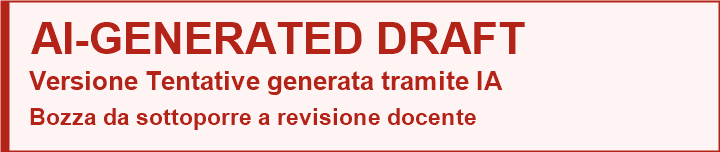

# Seconda media | Rapporti, forme e sistemi

> **AI-GENERATED DRAFT — Versione Tentative generata tramite IA.** Bozza di programma da sottoporre a revisione docente; la scansione annuale è una proposta, non un programma ministeriale prescritto. [Registro dell’attività IA](../../../docs/interazioni-ai/registro.md#ai-0003) · [Ricerca autonoma delle fonti](../../../docs/interazioni-ai/registro.md#ai-0014).

## Carico didattico

**Verifica delle fonti: 18/11/2026.**

| Disciplina e percorso | Ordinamento / coorte | Ore settimanali | Monte ore annuo | Fonte |
| --- | --- | --- | --- | --- |
| Matematica e scienze — tempo ordinario | Quadro nazionale del percorso | 6 | 198 | [DPR 89/2009, art. 5, commi 5 e 8](https://www.minori.gov.it/sites/default/files/dpr_89_2009.pdf) |
| Matematica e scienze — tempo prolungato | Quadro nazionale del percorso | 9 | 297 | [DPR 89/2009, art. 5, commi 5 e 8](https://www.minori.gov.it/sites/default/files/dpr_89_2009.pdf) |

Ore riferite al solo insegnamento congiunto di Matematica e scienze, in ciascuno dei tre anni. La norma non fissa qui due quote separate per Matematica e Scienze. Il percorso musicale aggiunge attività musicali e non aumenta queste ore; il tempo scuola complessivo è distinto dal carico disciplinare. Le nuove Indicazioni riguardano progressivamente le coorti entrate dal 2026/27.

Il monte annuo è ordinamentale; la corrispondenza settimanale usa 33 settimane convenzionali. Calendario, autonomia scolastica e attività della classe possono modificare la distribuzione effettiva.

[Fonti e confronto degli orari](../../../docs/ricerca-ai/carico-didattico-matematica.md) · [Metodo e limiti](../../../docs/ricerca-ai/carico-didattico.md) · [Verifica IA](../../../docs/interazioni-ai/registro.md#ai-0002).

**Riferimento.** Per la seconda del 2026/27 valgono le Indicazioni 2012. Dal 2027/28 arriva la prima coorte del nuovo curricolo. Si riparte da frazioni, poligoni, cellule e misure già incontrati. La distribuzione proposta va raccordata al lavoro effettivo della prima. [Indicazioni 2012](https://www.miur.gov.it/documents/20182/51310/DM%2B254_2012.pdf) · [DM 221/2025 e allegato](https://www.gazzettaufficiale.it/eli/id/2026/01/27/26G00021/sg)

## Programma proposto per nuclei tematici

**Ripartizione Tentative generata dall’IA:** **198 ore** (tempo ordinario); **297 ore** (tempo prolungato). Nei punti e nei subtotali i valori separati da «/» seguono questo stesso ordine e sono **alternativi**. I tempi comprendono spiegazione, esercitazioni e attività sul tema; le verifiche complessive e il recupero hanno una riserva distinta. La distribuzione per punto è una proposta di progettazione, non una prescrizione delle fonti. Percorso di lavoro, unità integrate e compito finale descritti più avanti utilizzano queste stesse ore e non si sommano.

### Matematica — rapporti e relazioni

**Subtotale: 47 h / 71 h.**

- **14 h / 21 h** — Operare con razionali, percentuali e proporzioni e interpretare la base di un confronto percentuale.
- **19 h / 29 h** — Riconoscere proporzionalità diretta e inversa attraverso tabelle, grafici e formule.
- **14 h / 21 h** — Usare espressioni letterali semplici per descrivere una misura o una relazione e controllarle sostituendo valori.

### Matematica — aree, radici e similitudine

**Subtotale: 47 h / 71 h.**

- **14 h / 21 h** — Ricavare aree per scomposizione e giustificare l’equivalenza di figure.
- **19 h / 29 h** — Usare radice quadrata e Pitagora in problemi di distanza; confrontare stima e calcolo.
- **14 h / 21 h** — Distinguere il rapporto di similitudine tra lunghezze e tra aree e leggere correttamente una pianta in scala.

### Scienze — chimica e movimento

**Subtotale: 24 h / 36 h.**

- **7 h / 11 h** — Descrivere soluzioni e concentrazioni e distinguere dissoluzione, passaggio di stato e reazione.
- **10 h / 14 h** — Rappresentare una trasformazione chimica con un modello semplice di particelle e conservazione della materia.
- **7 h / 11 h** — Misurare spazio e tempo, confrontare velocità medie e descrivere il ruolo delle forze in esperienze guidate.

### Scienze — corpo umano e relazioni ecologiche

**Subtotale: 24 h / 36 h.**

- **7 h / 11 h** — Collegare apparati digerente, respiratorio, circolatorio ed escretore nel funzionamento dell’organismo.
- **10 h / 14 h** — Descrivere movimento, sostegno e coordinamento, distinguendo osservazione scientifica e interpretazioni non fondate.
- **7 h / 11 h** — Collegare fotosintesi, respirazione e reti alimentari e ragionare sui trasferimenti di materia.

### Dati e indagine interdisciplinare

**Subtotale: 16 h / 24 h.**

- **5 h / 7 h** — Calcolare e interpretare medie e variabilità in piccoli insiemi di dati simulati o anonimi.
- **6 h / 10 h** — Confrontare un grafico spazio-tempo con una descrizione verbale e motivare il significato della pendenza.
- **5 h / 7 h** — Per la coorte che arriva dalla prima 2026/27 aggiungere un programma con variabili e controlli dei dati in ingresso, raccordandolo al lavoro precedente.

### Verifiche, restituzione e recupero

- **20 h / 30 h** — Verifiche di sintesi e restituzione ragionata, incluso il compito conclusivo della scheda.
- **20 h / 29 h** — Recupero dei prerequisiti, consolidamento e rimodulazione in base agli apprendimenti.

**Totale del piano: 198 h / 297 h.** I tempi vanno ricalibrati sul calendario effettivo e sulla classe.

## Unità integrate e prodotti attesi

### 1. Quanto è concentrata una soluzione?

- **Matematica:** Numeri razionali, rapporti, percentuali. Passare tra frazioni, decimali e percentuali
- **Scienze e laboratorio:** Soluzioni, solubilità e concentrazione. Distinguere dissoluzione e reazione chimica con esempi
- **Evidenza di apprendimento:** Calcolare la concentrazione in massa da soluto e massa totale. Spiegare il denominatore scelto

### 2. Forma, scala, movimento

- **Matematica:** Aree per scomposizione, equivalenza, radici e teorema di Pitagora. Disegni in scala
- **Scienze e laboratorio:** Moto e forze. Misurare tempi su distanze diverse e costruire il grafico spazio-tempo
- **Evidenza di apprendimento:** Usare una distanza diagonale ricavata da una pianta e confrontare velocità medie

### 3. Proporzionalità e organismi

- **Matematica:** Proporzionalità diretta e inversa, tabelle e grafici. Medie e variabilità
- **Scienze e laboratorio:** Corpo umano. Collegare apparati digerente, respiratorio e circolatorio e considerare il ruolo dell'alimentazione
- **Evidenza di apprendimento:** Descrivere una tabella con dati didattici su frequenza cardiaca e motivare una conclusione coerente con i dati

### 4. Cambiamenti e relazioni

- **Matematica:** Poligoni simili, rapporto fra lunghezze e fra aree. Espressioni letterali semplici
- **Scienze e laboratorio:** Reti alimentari, fotosintesi e respirazione, trasferimenti di materia in un ecosistema
- **Evidenza di apprendimento:** Disegnare una rete trofica e usare una proporzione per confrontare due campionamenti

**Compito finale.** Produrre il grafico spazio-tempo di un carrello su due tratti con velocità diverse. Consegnare i dati, spiegare il significato della pendenza e confrontare due calcoli di velocità media. Per la coorte del nuovo curricolo aggiungere un programma con variabili che calcoli la velocità e gestisca il caso di intervallo temporale nullo.

## Libri consigliati

- C. Bertinetto, A. Metiäinen, J. Paasonen, E. Voutilainen, *Contaci!*, seconda edizione, Zanichelli, volumi *Numeri, relazioni, dati 2* e *Misure, spazio e figure 2*. Per la seconda tappa usare il capitolo 2 di geometria sul teorema di Pitagora e chiedere una stima prima del calcolo. [Scheda e configurazioni](https://www.zanichelli.it/ricerca/prodotti/contaci-2ed) · [Esercizi del corso divisi per volume e capitolo](https://esercizi.zanichelli.it/corso/Contaci-Seconda-edizione/2000062489)
- S. Saraceni, G. Strumia, *Osservare e capire le scienze*, edizione verde, seconda edizione, Zanichelli, vol. 2, ISBN 9788808375391. Il volume propone un'attività sulla concentrazione con il foglio di calcolo e una sulla frequenza cardiaca. Si prestano rispettivamente alla prima e alla terza tappa. [Scheda del volume 2](https://staticmy.zanichelli.it/catalogo/assets/9788808375391_03_ALT.pdf)

[Indice del triennio](README.md)

## Fonti consultate per questa proposta

- [DM 254/2012, Gazzetta Ufficiale, copia UMI](https://umi.dm.unibo.it/wp-content/uploads/2013/10/6_DM_254_12_GU_30_5_2_13.pdf): riferimento per le coorti che concludono il percorso precedente; estrazione testuale degli allegati parziale.
- [DM 221/2025 e allegato, copia della Gazzetta Ufficiale presso IC Kennedy](https://www.ic58jfkennedy.edu.it/wp-content/uploads/2026/02/Decreto-Ministeriale-9-dicembre-2025-n.-221.pdf): artt. 1 e 5 e sezioni Matematica/Scienze: applicazione dalle prime 2026/27.
- [INVALSI, Quadro di riferimento delle prove di matematica](https://www.invalsi.it/wp-content/uploads/2024/09/QdR_MATEMATICA.pdf): confronto sui processi di conoscenza, soluzione di problemi e argomentazione; non programma annuale.
- [Istat, Pacchetti didattici per le scuole](https://www.istat.it/attivita-e-servizi-per-tipo-di-utenti/studenti-e-docenti/pacchetti-didattici/): indice tematico consultato; allegati PPSX non letti dallo strumento web.
- [INGVambiente, Materiale per la scuola](https://ingvambiente.com/materiale-per-la-scuola/): pagina tematica su Terra, ambiente e fenomeni naturali; non sono stati letti tutti i percorsi collegati.

Date, perimetro di consultazione e limiti di accesso: [catalogo della ricerca autonoma — matematica-e-scienze](../../../docs/ricerca-ai/fonti-programmi/matematica-e-scienze.md). Le attività e la scansione proposte sono una rielaborazione didattica dell’IA, da verificare sul curricolo della scuola.
